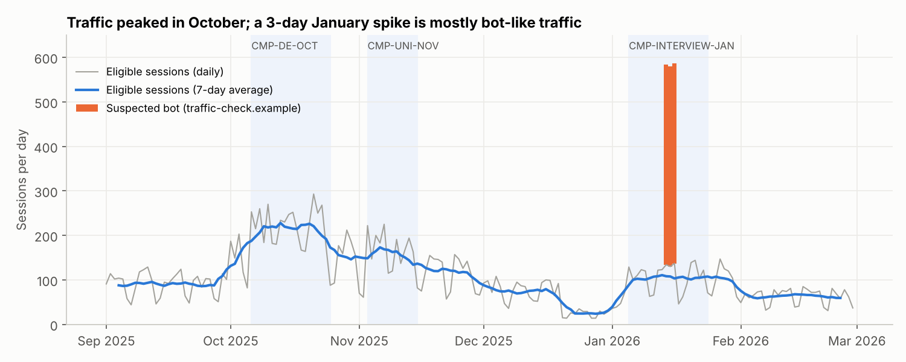
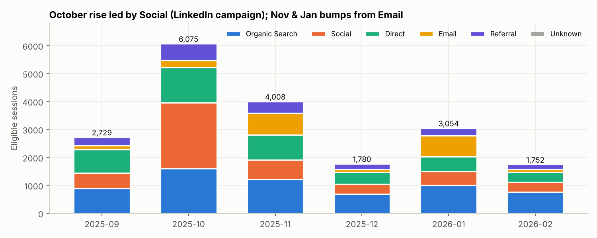
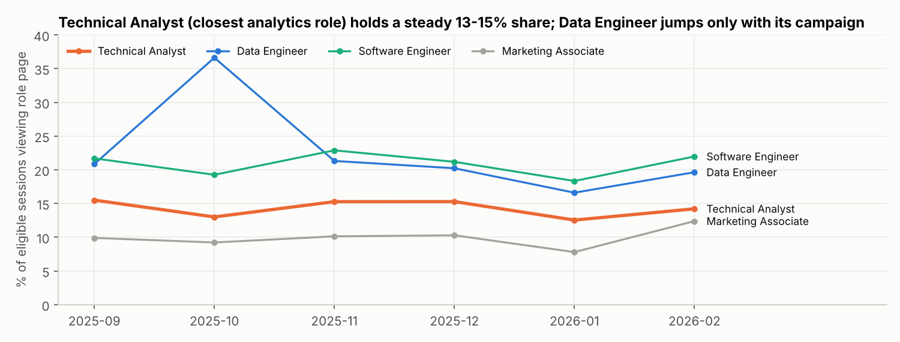
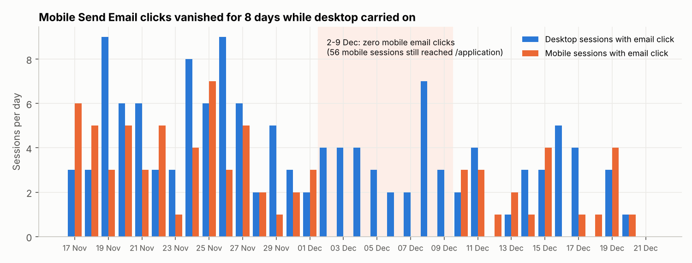
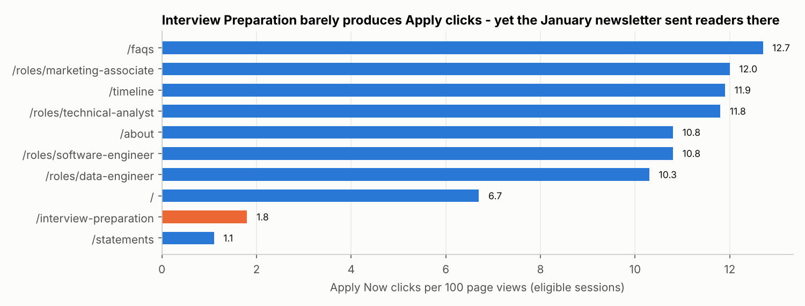

# Elanco Students website: findings report

*Daluut Warsame*

*All data is synthetic (1 Sep 2025 – 28 Feb 2026). Findings describe the fictional export, not the real website.*

**Population.** 20,748 tracked sessions after removing duplicates. 1,350 of these are flagged as suspected bot traffic, which leaves **19,398 eligible sessions**. All rates below use eligible sessions as the denominator and count *distinct sessions*, never events.

**Headline numbers.** 16.5% of eligible sessions clicked Apply Now. 21.0% viewed `/application`. **7.2% clicked Send Email** (1,396 sessions). A Send Email click shows *intent to apply*. We cannot see whether an email was sent or an application received.

## 1. How traffic changed, and what drove it

- **October was the peak** (6,075 sessions, 2.2× September). Social was the largest contributor (+1,802 sessions), mostly LinkedIn during the Data Engineer campaign (6–24 Oct). But **sessions with no campaign also rose 67%**, and the climb began before the campaign started. October therefore looks like placement season plus the campaign. Timing overlap does not prove the campaign caused the rise.
- **November and January bumps came from Email**: the university newsletter (Nov) and the interview reminder (Jan).
- **December fell to 1,780 sessions** with a deep trough over Christmas. This is consistent across every channel, so it is most likely genuine seasonal behaviour.

## 2. Interest in the Data Analyst placement

**There is no Data Analyst page.** It is not in `pages.csv`, and no event URL contains one. The site lists Data Engineer, Software Engineer, Technical Analyst and Marketing Associate. I did not rewrite any page into a "Data Analyst" page. Instead I used **Technical Analyst as a clearly labelled proxy**, as the closest analytics role. An interested session is defined as any eligible session with ≥1 view of `/roles/technical-analyst`.

| Group | Sessions | Email-click rate (95% CI) | Apply Now rate |
|---|---|---|---|
| Technical Analyst viewers | 2,729 | **7.3%** (6.3–8.2%) | 19.4% |
| Viewers of other role pages only | 10,210 | 6.2% (5.7–6.7%) | 18.5% |

- Technical Analyst interest is **steady at 13–15% of sessions every month**. Unlike Data Engineer, it was never promoted, and it never spiked.
- Its viewers click Send Email slightly more often than other role viewers. The confidence intervals barely overlap, so treat this as *suggestive, not proven*.
- Its traffic is more Organic Search-led (35% vs 30%), meaning people are actively searching for it.

## 3. Unusual periods: behaviour change or data problem?

**A. 14–16 Jan spike → almost certainly bots (data problem).** 1,350 sessions came from `traffic-check.example`. They are 100% desktop and 100% US/Singapore. Every session is a new visitor viewing exactly one page (the home page). There were zero clicks, spread across 23 hours of the day. Real visitors are 42% desktop, 5% US/SG, and 18% click Apply or Email. These sessions are **flagged and excluded** from eligible metrics. Left in, they would cut that week's email-click rate by about two-thirds.

**B. 2–9 Dec: mobile Send Email clicks fell to zero (likely a tracking or site fault).** 56 mobile sessions reached `/application` and none clicked Send Email. At the usual mobile rate (~29%) we would expect about 16. Desktop was normal (45%). Other mobile events (Apply Now, video) kept recording, so tracking was not down entirely. The fault is specific to the mobile Send Email action: either the tag stopped firing or the button broke. The data cannot tell these apart, but neither is genuine behaviour change.

**C. January newsletter landed people on a dead end (behaviour).** 85% of interview-reminder sessions landed on Interview Preparation. That page produces **1.8 Apply clicks per 100 views**, against ~11 on role and FAQ pages. These sessions' email-click rate was 2.9%, well under half the 7.2% average.

## 4. Recommendations

1. **Fix and monitor the mobile Send Email action.** Mobile is 54% of sessions, but mobile visitors who reach `/application` click Send Email far less often than desktop (28% vs 40%), and the action failed completely for 8 days. Test the `mailto` flow on phones, and offer a fallback such as a copy-the-address button or a form. *Measure:* mobile email-clicks per application viewer, with an alert when it drops to zero.
2. **Add a clear Apply Now route to Interview Preparation**, and point future campaigns at role pages, as the October campaign did (8.7% email rate). *Measure:* Apply clicks per 100 views on that page, and email rate for campaign sessions, compared before and after the change.
3. **Clarify the Data Analyst placement and filter bot traffic at source.** If a Data Analyst placement exists, it needs its own page so interest can be measured directly. Block or label `traffic-check.example`-style traffic in the tracking tool. *Measure:* role-page sessions, and the share of single-page, zero-action sessions by source.

## Limitations and AI use

Tracked sessions only: consent refusals, blockers and cross-device journeys are invisible, so these are not counts of people. There is no data on applications, spend or impressions, so no ROI or completed-conversion claims are possible. Campaign effects are associations, not causes. The funnel compares distinct-session populations rather than requiring a strict order (see quality note). **AI use:** I used Claude (Anthropic) to help profile the data, draft the Python pipeline and charts, and structure this report. I reviewed and reran all code, and checked every figure against the output tables.
